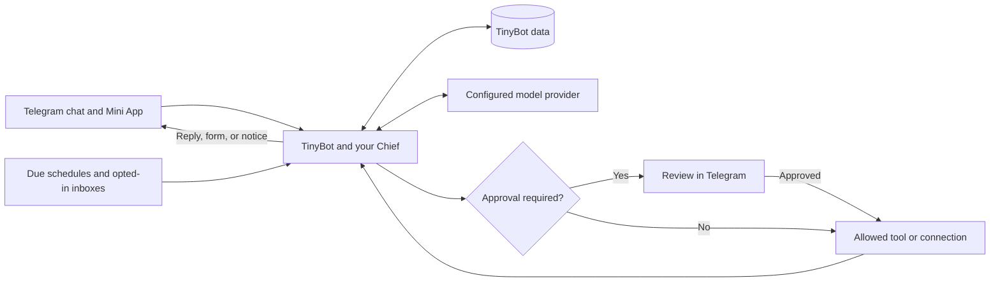

# How data flows through TinyBot

TinyBot runs on your server. Telegram carries messages and displays the Mini
App. TinyBot keeps the task state, decides which actions are allowed, and calls
the model and services you’ve connected.

## From message to reply

1. **Receive.** Your bot receives a private message through Telegram. TinyBot
   checks who sent it and identifies the active task. A reply to an earlier
   bot message can bring the relevant context back into the turn. The Mini
   App uses Telegram-signed launch data to open your account settings.
2. **Gather context.** The Chief gets the request, recent task history,
   relevant saved memories, and any attachment or email you’ve made available.
   TinyBot summarizes older context in longer tasks. The configured model
   provider processes the context needed for that turn.
3. **Work.** The Chief can answer immediately, call a tool, or delegate to a
   helper. It carries the helper’s result back into the main conversation.
   The Chief and its helpers share a 100-tool-attempt budget per turn. With a
   configured OpenRouter key, Jev checks for repeated work every 10 attempts.
4. **Reply.** TinyBot formats the result for Telegram and queues it for
   delivery. Supported clients can show a streamed draft while the Chief
   works. The final reply can include links, tables, and buttons.

A scheduled task begins with its saved prompt. An automated email task starts
with your handling instruction for that folder. Both return the result to the
same private Telegram chat.

## Tools and approvals

The model proposes a tool call. TinyBot checks the current task, connection,
and permissions before acting. Automatic connections compare the proposed effect with the private owner instruction or the versioned standing rule. The worker claims a durable authorized action and rechecks its scope before execution. When a tool needs approval, the task waits
and TinyBot shows what the operation will do. An approval applies to the
request you reviewed. A newer message can replace a waiting request.

| Operation | Where the data goes and who approves |
| --- | --- |
| Browse or search the web | The local browser worker reads public HTTPS pages. Enabled OpenRouter tools can also search and fetch through OpenRouter. A configured browser proxy routes browser traffic through that proxy. |
| Call MCP | TinyBot sends the tool arguments to the connected server. For AnythingMCP, the gateway forwards the request to the underlying service. TinyBot can approve a read automatically through its configured read policy and Jev. Other calls can ask you to approve once, always approve the exact tool on that connection, or deny. |
| Submit a website form | The Mini App sends your entries directly to TinyBot. TinyBot keeps the private values in memory until use or expiry and offers an optional masked preview. The browser worker submits the values after approval. |
| Send email | TinyBot shows the exact sender, recipients, subject, and body. A matching owner instruction authorizes a send on an automatic connection. A review-mode connection opens the exact draft for approval. The email server receives the approved message. |
| Run Python on task files | TinyBot gives the files needed for that job to an offline worker and returns the output to the task. |

If TinyBot restarts after an approved action starts, it may be unable to
confirm what happened at the destination. Check the destination and use
`/reconcile` before continuing that task. This protects operations such as
email sends and website submissions from an automatic repeat.

## What TinyBot stores and shares

| Data | Handling |
| --- | --- |
| Tasks and memory | SQLite keeps task history, summaries, schedules, and saved memories. The Chief can recall its private notes, notes for your owned helpers, and group notes for your own agents. Invited users can use the notes that a helper’s owner publishes for sharing. |
| Credentials and files | TinyBot encrypts saved model, connector, and mail credentials, retrieved email content, and supported uploads. A model provider receives the context or attachment content needed for the request. Voice transcription sends the recording to OpenRouter, and the transcript becomes part of the task history. |
| Incoming mail | Notify-only folders show a redacted notice. The sender, subject, and body become available to the Chief when you tap **Read more** or reply to that notice. For opted-in folders the Chief can use the mail text automatically and follow your folder instruction. |
| Audit log | TinyBot keeps seven days of redacted run records, with a timeline and model usage as reported. The signed Mini App can export a complete retained run as JSON, including entries beyond the visible page. The file is created in your browser. |
| AnythingMCP | The bundled gateway has its own PostgreSQL database and credentials. Its user roles constrain which tools the TinyBot connection can see. TinyBot also applies its own permissions and approvals to calls through the gateway. |

For step-by-step controls, see [Features and examples](features.md). For
hosting and backup instructions, see [Setup and operations](setup.md).
